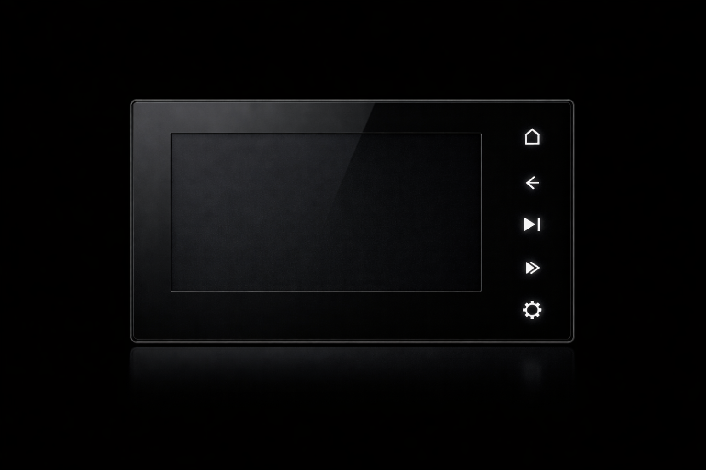
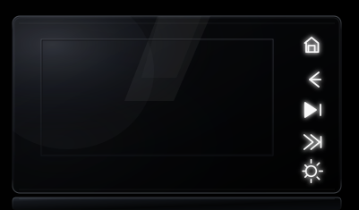
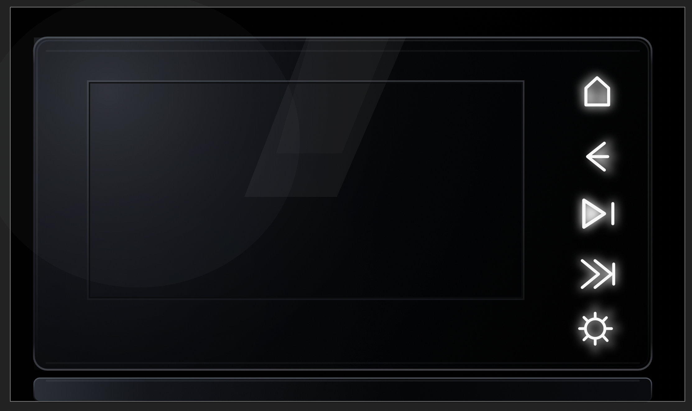
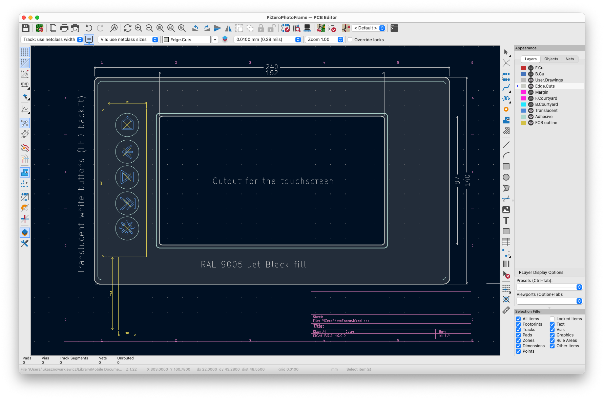
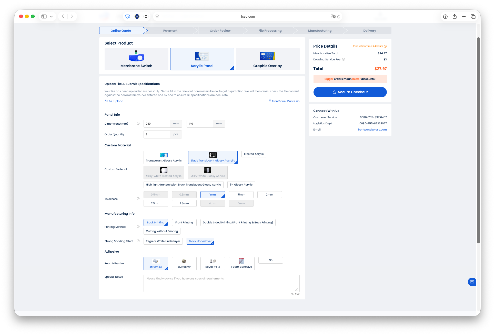
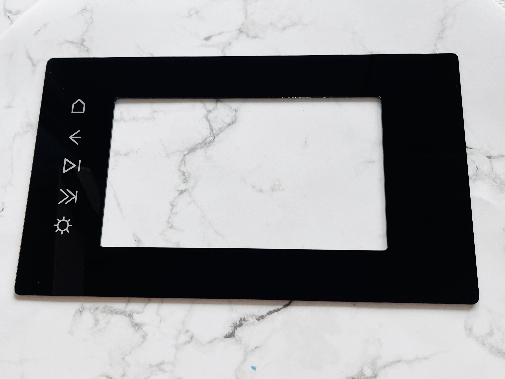
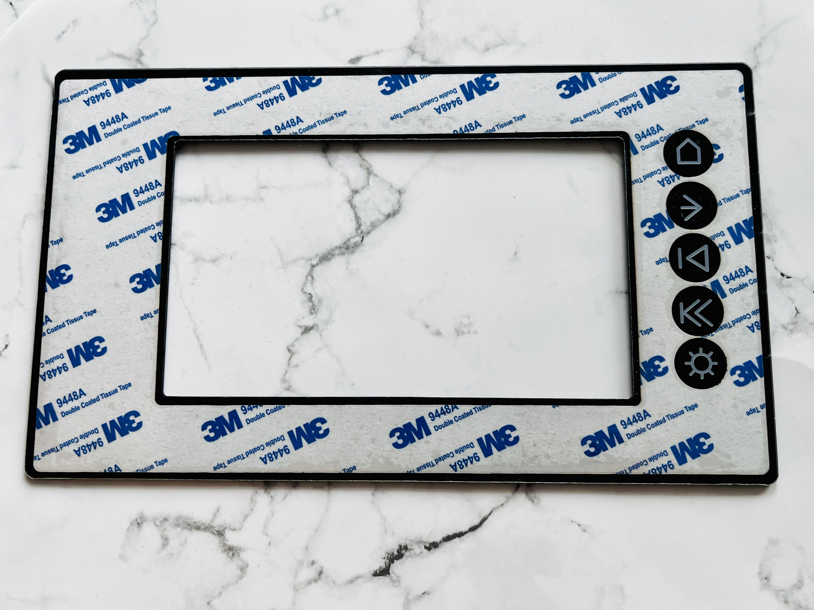
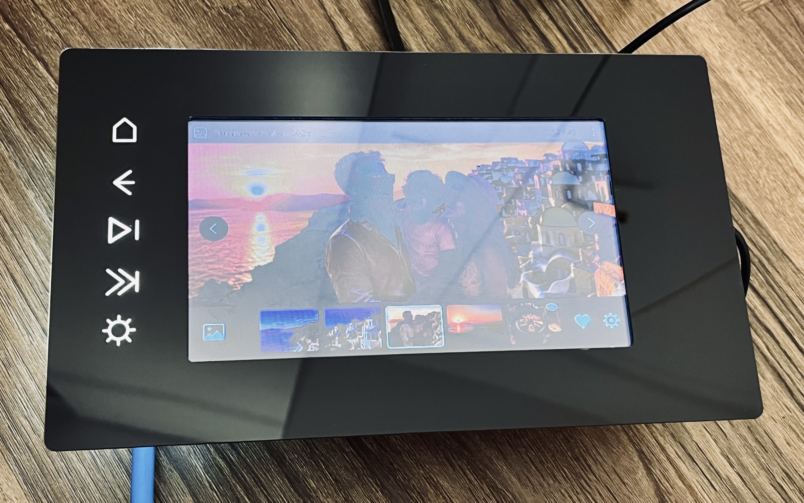
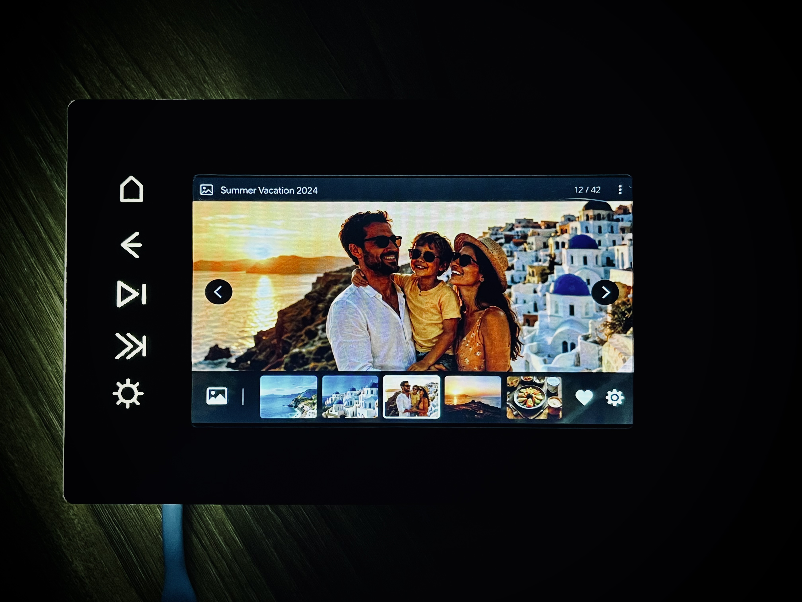

# PiPhotoFrame-AcrylicFrontPanel  
  
### Motivation  
  
I was curious to see how well LCSC’s acrylic panel design service works, so I decided to create a front panel for a Raspberry Pi Zero photo frame. It should have a shiny surface, a few buttons, an LED backlight, and a cutout for the LCD screen.  
  
### Design  
  
An initial design idea was requested from ChatGPT, and after a few prompts, a satisfactory result was achieved.  
  
  
  
Then asked for vectorized version:  
  
  
  
And made some manual corrections:  
  
  
  
  
For creating mechanical drawings, I used KiCad as CAD software. I converted SVG to DXF using an online tool and imported it into KiCad. I renamed layers to reflect their functions in panel design: panel edges, glue, translucent, and parts. There is no structured way for doing this; it was just my approach to make that information clear.   
  
  
  
Submitted order on LCSC:  
  
  
  
  
  
### Received panels  
  
Panels came out very good. Keep dimensions, everything as expected, cutout, buttons outlook.   
  
  
  
  
  
### Assembled photo frame  
  
Assembled the frame with the LCD screen, Raspberry Pi, and buttons backlight. I personally like how it came out. It looks pretty good, especially in the dark.   
  
  
  
  
  
  
  
  
  
  
